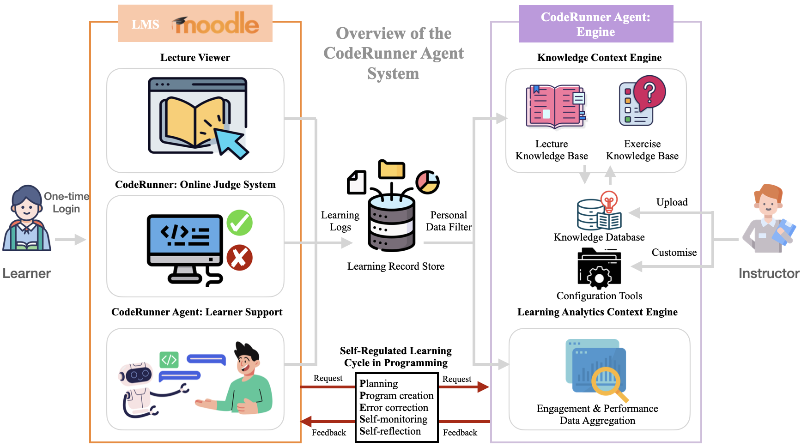
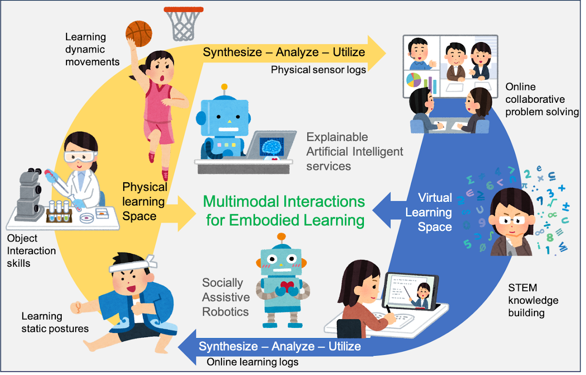
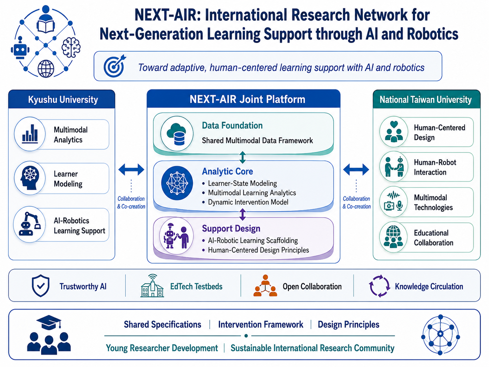
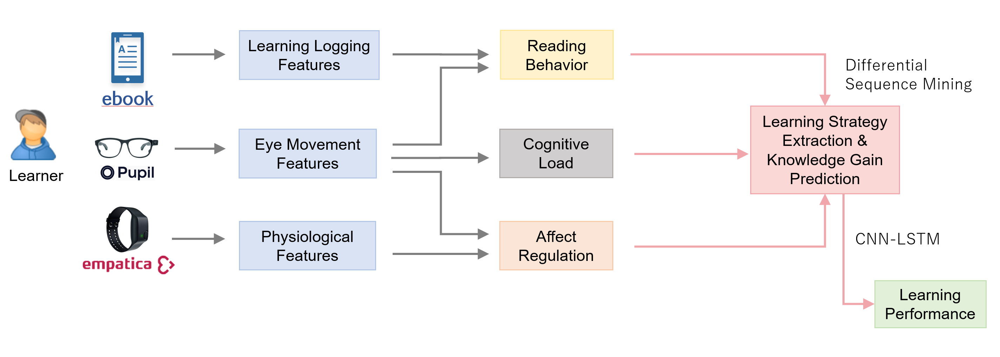
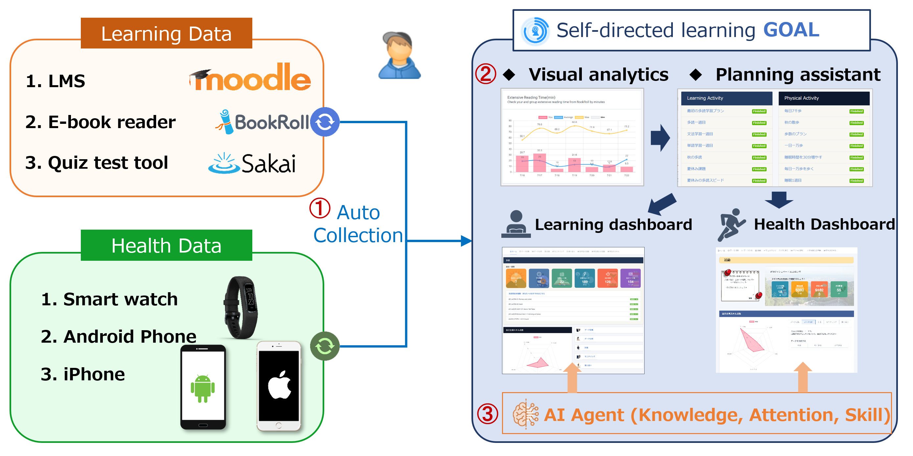
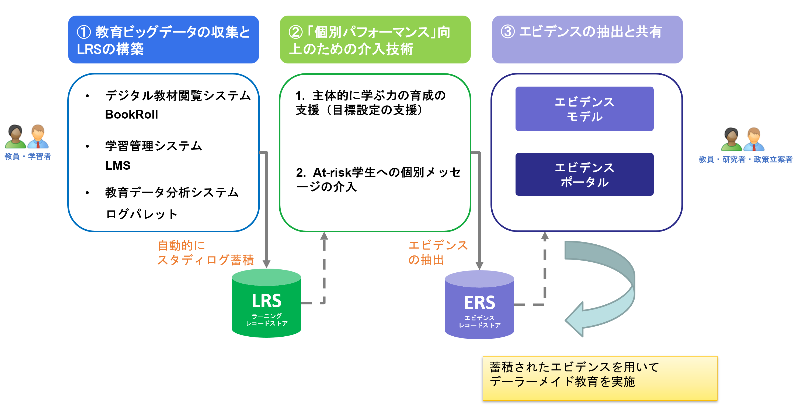



Publically funded projects: [JSPS KAKEN](https://nrid.nii.ac.jp/en/nrid/1000060913910/){:target="_blank"}, [research-er.jp](https://research-er.jp/researchers/view/992994){:target="_blank"}

<table class="project-list" role="presentation">
  <tbody>
    <tr>
      <td>
        <h2>
          <a href="https://li-huiyong.github.io/MetaStep" target="_blank" rel="noopener noreferrer">
            MetaStep: Large Language Model-based Metacognitive Scaffolding in Introductory Programming Education
          </a>
        </h2>
        

          JSPS Grant-in-Aid for Early-Career Scientists <a href="https://kaken.nii.ac.jp/ja/grant/KAKENHI-PROJECT-25K17078/">(25K17078)</a>
           
          2025-04-01 – 2028-03-31
           
          <a href="https://li-huiyong.github.io/MetaStep">Project Page</a>
          |
          <a href="https://doi.org/10.48550/arXiv.2504.03068">arxiv</a>
          | Code
        

        

          This project aims to develop MetaStep, an LLM-based support system designed to promote self-regulated learning in introductory programming education. By seamlessly integrating students’ cognitive and metacognitive models into LLM-based scaffolding, MetaStep enables a gradual transfer of regulatory control from AI to students, supporting their development into self-directed learners.
        

        
      </td>
    </tr>

    <tr>
      <td>
        <h2>
          <a href="https://li-huiyong.github.io/GazeAgency/" target="_blank" rel="noopener noreferrer">
            GazeAgency: Utilising Dynamic AOI tracking and Machine Learning for Investigating Learner Agency in AI-Mediated Online Learning Environments
          </a>
        </h2>
        

          <a href="https://www.jst.go.jp/program/india/outline/">JST LOTUS Programme</a>
           
          <time datetime="2026-10-01">2026-10-01</time> – <time datetime="2027-09-30">2027-09-30</time>
           
          <a href="https://li-huiyong.github.io/GazeAgency/">Project Page</a>
        

        

          This Japan–India collaborative project investigates <strong>dynamic AOI tracking and machine learning</strong> as methods for understanding <strong>learner agency</strong> in AI-mediated online learning environments. Integrating gaze analysis, behavioural pattern detection, and NLP-based descriptions, the project will extend existing analytical methods and evaluate their applicability within Kyushu University’s AI-supported learning environment. It aims to advance methodological approaches for investigating learner agency, generate preliminary findings and strengthen international collaboration in AI-supported education and learning analytics.
        

      </td>
    </tr>

    <tr>
      <td>
        <h2>
          <a href="https://sites.google.com/view/mixailearn/home" target="_blank" rel="noopener noreferrer">
            miXai^learn: Multimodal Interactions, and Explainable AI for Embodied learning
          </a>
        </h2>
        

          JSPS Fund for the Promotion of Joint International Research (International Collaborative Research) <a href="https://kaken.nii.ac.jp/en/grant/KAKENHI-PROJECT-24KK0051/">(24KK0051)</a>
           
          2024-09-09 – 2027-03-31
           
          <a href="https://sites.google.com/view/mixailearn/home">Project Page</a>
        

        

          This joint research takes the standpoint that learning has embodied experiences distributed in the physical and virtual spaces. While current online learning systems often focus on the cognitive skills, there is a lack of data-driven approaches for tracking learning process and provide feedback on tasks that are distributed in physical and virtual spaces. This research explores an innovative integration of Artificial Intelligence (AI) and socially assistive robotics in a technical infrastructure to enhance learner’s critical reflection in the psychomotor and cognitive aspects of learning.
        

        
      </td>
    </tr>

    <tr>
      <td>
        <h2>
          <a href="https://li-huiyong.github.io/NEXT-AIR" target="_blank" rel="noopener noreferrer">
            NEXT-AIR: International Research Network for Next-Generation Learning Support through AI and Robotics
          </a>
        </h2>
        

          Researcher Network Formation Promotion Program with Strategic Partners (Kyushu University)
           
          2026-05-15 – 2027-03-31
           
          <a href="https://li-huiyong.github.io/NEXT-AIR">Project Page</a>
        

        

          This project is an international collaboration between Kyushu University and National Taiwan University to explore how AI and robotics can support next-generation education. It brings together experts, young researchers, and graduate students to develop multimodal learning analytics, design adaptive intervention models, and formulate human-centered design principles for next-generation embodied learning.
        

        
      </td>
    </tr>

    <tr>
      <td>
        <h2>
          <a href="https://li-huiyong.github.io/MMLAIR" target="_blank" rel="noopener noreferrer">
            MMLAIR: Multimodal Learning Analytics in Reading
          </a>
        </h2>
        

          Education and Research Support Program on Mathematical and Data Science (Kyushu University)
           
          2024-06-18 – 2025-03-31
           
          <a href="https://li-huiyong.github.io/MMLAIR">Project Page</a>
        

        

          This project analyzes students' behavioral, cognitive, and emotional patterns during digital reading to understand learning processes and predict knowledge outcomes. By continuously monitoring multimodal data from learning logs, eye-tracking, and physiological sensors, the research enables adaptive learning systems that respond dynamically to individual student states, supporting personalized educational interventions in real-time.
        

        
      </td>
    </tr>

    <tr>
      <td>
        <h2>
          <a href="https://sites.google.com/view/letsgoal" target="_blank" rel="noopener noreferrer">
            GOAL project: AI-supported self-directed learning lifestyle in data-rich educational ecosystem
          </a>
        </h2>
        

          JSPS Grant-in-Aid for Scientific Research (B) <a href="https://kaken.nii.ac.jp/ja/grant/KAKENHI-PROJECT-23K25156/">(23K25156)</a>
           
          2022-04-01 – 2025-03-31
           
          <a href="https://sites.google.com/view/letsgoal">Project Page</a>
          |
          <a href="https://sites.google.com/view/letsgoal/publication">Publications</a>
        

        

          Learners need to be trained to be self-directed in their learning and daily activities. This research focuses on developing digital learning environments that trace learners' behaviors and provide them functionalities to develop such self-direction skills by analysis of those data.
        

        
      </td>
    </tr>

    <tr>
      <td>
        <h2>
          <a href="https://www.let.media.kyoto-u.ac.jp/en/sip2/" target="_blank" rel="noopener noreferrer">
            Cyberspace Infrastructure Technology Using Big Data and AI: Research on Evidence-Based Tailor-Made Education
          </a>
        </h2>
        

          The Second Phase of Cross-ministerial Strategic Innovation Promotion Program (SIP2) <a href="https://www.nedo.go.jp/activities/ZZJP2_100126.html">(JPNP18013)</a>
           
          2018-11-15 - 2023-03-31
           
          <a href="https://www.let.media.kyoto-u.ac.jp/en/project/sip/">Project Page</a>
          |
          <a href="https://www8.cao.go.jp/cstp/gaiyo/sip/sip2_seika/big3.pdf">Final Report in JP (p.31-36)</a>
        

        

          In this research, we collect and analyze learning data logs which is otherwise difficult to synthesize automatically and requires advanced interaction tracking. The approach consumes the domain knowledge of learning and cognitive science, artificial intelligence, and information and communication infrastructure technology. By researching and developing the AI driven pedagogical platform, we aim to realize a precision education that can be tailored to the characteristics of learners based on evidence.
        

        
      </td>
    </tr>
  </tbody>
</table>
